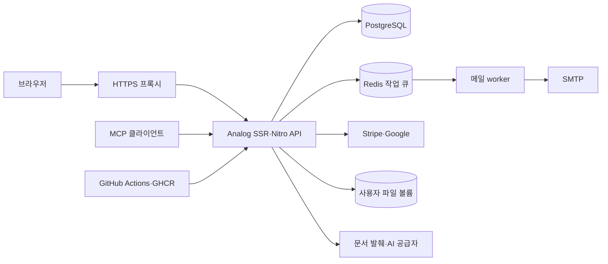

# studyFinal · 최종 프로젝트 · Analog 게시판과 문서 질의

## ① 목표

중간 게시판을 PostgreSQL 기반으로 확장하고 외부 서비스, AI, MCP, 운영 흐름을 하나로 연결한다.

## ② 📖 이론

중간 단계의 v1 계약이 앱의 기준점이다. DB와 외부 API가 늘어날수록 인증·설정·응답의 경계를 분명히 한다. 여러 접수 창구가 같은 출입증과 원본 장부를 사용하는 구조와 같다.

### 기능 목록

- 로그인·작성자 권한, v1 글·댓글 CRUD와 SSR 목록, SSG 블로그
- PostgreSQL, DB 이전, Material·Signal Forms, Swagger/OpenAPI
- Stripe 테스트 결제, Google OAuth, SMTP와 Redis 큐, 사용자 파일 업로드
- 실시간 신규 글 알림, 발췌 기반 문서 Q&A·SSE·기록, 인증된 MCP 검색
- Docker, readiness, 로그·백업 및 GitHub Actions 배포

## ③ 🛠️ 실기

실습 명령과 `src/` 경로는 `lesson/`을 기준으로 합니다. 아래 전체 코드의 파일명은 저장소 루트 기준입니다.

### 연동 구성도



### 구현 순서

1. [studyMidpoint](studyMidpoint.md)의 API 검증을 통과시킨다. SQLite에서 실제 쓰기가 있다면 중지·백업 후 [study11](study11.md)의 이전 스크립트를 실행한다.
2. [study12](study12.md)의 Material/Signal Forms로 편집기를 적용하고 v1 입력과 응답을 확인한다.
3. [study13](study13.md)의 테스트 Stripe·SMTP·OAuth 값을 설정하고 업로드 소유권을 확인한다.
4. [study14](study14.md)의 `/api-docs`에서 계약을 조회하고 [study15](study15.md)의 캐시와 큐를 점검한다.
5. [study17](study17.md)의 알림과 [study18](study18.md)의 문서 질문, 발췌, SSE, MCP를 같은 로그인으로 실행한다.
6. [study16](study16.md)의 Compose와 Actions를 적용하고 아래 순서대로 검증한다.

```powershell
npm run typecheck
npm test
npm run build
npx playwright install chromium
npm run test:e2e
docker compose up -d --build
curl.exe -i http://localhost:3000/api/ready
```

### `lesson/compose.yaml` 전체 코드

```yaml
services:
  board:
    image: ${BOARD_IMAGE:-analog-board:local}
    build: .
    ports: ["127.0.0.1:${BOARD_PORT:-3000}:3000"]
    environment:
      APP_SECRET: ${APP_SECRET:?set APP_SECRET in .env}
      APP_ORIGIN: ${APP_ORIGIN:?set APP_ORIGIN in .env}
      CORS_ORIGIN: ${CORS_ORIGIN:-}
      COOKIE_SECURE: ${COOKIE_SECURE:-true}
      DB_CLIENT: pg
      DATABASE_URL: ${DATABASE_URL:?set DATABASE_URL in .env}
      REDIS_URL: redis://redis:6379
      SMTP_URL: ${SMTP_URL:-}
      MAIL_FROM: ${MAIL_FROM:-}
      STRIPE_SECRET_KEY: ${STRIPE_SECRET_KEY:-}
      STRIPE_WEBHOOK_SECRET: ${STRIPE_WEBHOOK_SECRET:-}
      STRIPE_PRICE_ID: ${STRIPE_PRICE_ID:-}
      GOOGLE_CLIENT_ID: ${GOOGLE_CLIENT_ID:-}
      GOOGLE_CLIENT_SECRET: ${GOOGLE_CLIENT_SECRET:-}
      AI_PROVIDER: ${AI_PROVIDER:-demo}
      AI_MODEL: ${AI_MODEL:-}
      AI_DAILY_REQUEST_LIMIT: ${AI_DAILY_REQUEST_LIMIT:-20}
      ANTHROPIC_API_KEY: ${ANTHROPIC_API_KEY:-}
      OLLAMA_URL: ${OLLAMA_URL:-http://host.docker.internal:11434}
    volumes: ["uploads:/app/data"]
    restart: unless-stopped
    depends_on:
      db: { condition: service_healthy }
      redis: { condition: service_started }
    logging:
      options: { max-size: "10m", max-file: "3" }
  db:
    image: postgres:17-alpine
    environment:
      POSTGRES_DB: board
      POSTGRES_USER: board
      POSTGRES_PASSWORD: ${POSTGRES_PASSWORD:?set POSTGRES_PASSWORD in .env}
    volumes: ["db:/var/lib/postgresql/data"]
    healthcheck:
      test: ["CMD-SHELL", "pg_isready -U board -d board"]
      interval: 5s
      timeout: 3s
      retries: 12
    restart: unless-stopped
  redis:
    image: redis:7-alpine
    command: ["redis-server", "--appendonly", "yes"]
    volumes: ["redis:/data"]
    restart: unless-stopped
  mailpit:
    image: axllent/mailpit:v1.27
    profiles: ["mail-test"]
    ports: ["127.0.0.1:8025:8025"]
  proxy:
    image: caddy:2-alpine
    profiles: ["tls"]
    environment:
      BOARD_DOMAIN: ${BOARD_DOMAIN:-localhost}
    ports: ["80:80", "443:443"]
    volumes: ["./Caddyfile:/etc/caddy/Caddyfile:ro", "caddy:/data"]
    depends_on: ["board"]
    restart: unless-stopped
volumes:
  db:
  redis:
  uploads:
  caddy:
```

- 1행 앱과 외부 실행 의존성을 선언한다.
- 2–6행 동일 이미지로 SSR·HTTP·WS를 제공한다.
- 7–10행 쿠키 서명 키를 런타임에 주입한다.
- 11–12행 최종 운영 DB를 PostgreSQL로 바꾼다.
- 13–25행 큐를 Redis 컨테이너로 연결한다.
- 26–28행 업로드 파일을 영속 볼륨에 둔다.
- 29–50행 영속 PostgreSQL과 startup 검사 설정을 제공한다.
- 51–54행 로컬 메일 수신 시험을 선택적으로 실행한다.
- 55–68행 TLS 프로필의 Caddy와 도메인 설정을 제공한다.

### `lesson/Caddyfile` 전체 코드

```text
{$BOARD_DOMAIN} {
  request_body {
    max_size 64KB
  }
  reverse_proxy board:3000
  log {
    output stdout
  }
}
```

- 1행 DNS와 일치하는 사이트 주소를 지정한다.
- 2–4행 프록시 요청 본문에 크기 상한을 적용한다.
- 5행 UI·API·WebSocket을 Analog에 전달한다.
- 6–9행 운영 요청 로그를 프로세스 표준출력으로 보낸다.

## ④ 🔗 연동 포인트

자동 배포는 `production` 호스트 시크릿과 리포지터리 변수를 활성화했을 때 실행된다. Stripe와 Google의 실제 콜백에는 해당 서비스의 테스트 계정·키가 필요하다. AI는 demo 기본 실행을 검증한 뒤 운영 Secret에 실제 모델 설정을 추가한다.

## ⑤ 오류 노트

| 증상 | 원인 | 해결 |
| --- | --- | --- |
| 배포 뒤 502 | 새 인스턴스가 준비되지 않음 | 프록시와 `/api/ready`, 이미지·DB 로그를 확인하고 필요시 이전 이미지를 사용한다. |
| AI 공급자 장애 | 모델 ID, 키 또는 Ollama 주소 불일치 | 서버 환경 설정, 데모·공급자별 응답 확인 및 사용자 오류 상태를 확인한다. |
| OAuth나 결제 콜백에 접근 불가 | 공개 URL과 공급자 등록 정보 불일치 | HTTPS Origin과 등록 경로를 비교한다. |

## ⑥ 직접 해보기

1. Docker 실행 중 글을 써서 재시작 후 보존되는지 확인한다.
2. 한 사용자로 업로드와 AI 질의, 다른 사용자로 파일 접근 차단을 확인한다.
3. 백업을 새 DB에 복원하고 API 목록·댓글 수를 비교한다.

## ⑦ ☐ 체크리스트

- [ ] 운영 DB 전환과 기존 데이터 이관·백업 복원 확인
- [ ] HTTPS 쿠키·CSRF·CORS·작성자·파일 권한 확인
- [ ] 외부 공급자 테스트 키·웹훅 서명·메일 수신 확인
- [ ] AI 발췌·SSE·한도와 MCP Bearer 검증
- [ ] Docker·Actions·readiness·로그·롤백 확인

## ⑧ 다음 단계

### 회고

중간의 API 계약 덕분에 DB 전환과 UI 확장 후에도 기존 글과 댓글 경로를 유지했다. 운영에서는 큐와 DB를 영속화하고 실시간 알림·캐시는 단일 인스턴스의 경계를 알고 검증해야 한다. 외부 키가 들어가는 실제 결제·소셜 로그인·모델 테스트는 계정과 배포 환경에서 수행한다.

완료 시점의 버전, 백업 복구 결과, 운영 공급자별 확인 결과를 남겨 다음 Analog 운영 실습의 기준으로 사용한다.

[참고 문서](https://app.notion.com/p/41fd7dec5e2e81a1a6d6e9f69d8a948e)

## Notion 체크 항목 미반영

| Analog 페이지 원문 | 이유 |
| --- | --- |
| 기존 Angular 게시판 컴포넌트를 옮겨 Angular CLI 프로젝트와 비교 | 이번 요청의 Analog 단일 프레임워크 범위와 비교 금지 조건. 게시판 구성요소는 이 저장소 안에서 새로 작성했다. |
