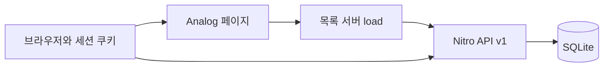

# studyMidpoint · 중간 프로젝트 · Analog 게시판

## ① 목표

study0~10만으로 로그인과 글·댓글 CRUD를 제공하는 Analog 게시판을 완성한다.

## ② 📖 이론

페이지와 API가 같은 출처에 있으면 브라우저 쿠키를 공유할 수 있다. 서버 load는 첫 화면을 빠르게 구성하고 브라우저는 쓰기 API를 호출한다. 목록은 카탈로그, 폼은 접수 창구, DB는 원본 장부다.

### 기능 목록

- 회원가입·로그인·로그아웃과 작성자 접근 제어
- 글 목록·검색·페이지 이동 및 상세·등록·수정·삭제
- 댓글 목록·작성·삭제, 입력 검증, Markdown 안내 페이지

## ③ 🛠️ 실기

실습 명령과 `src/` 경로는 `lesson/`을 기준으로 합니다. 아래 전체 코드의 파일명은 저장소 루트 기준입니다.

### 폴더 구조

```text
lesson/
  src/app/pages/       account, posts, blog
  src/app/board/       카드, 본문, 글 편집기
  src/app/core/        요청·세션
  src/server/routes/   health, API 파일
  src/server/lib/      DB, 저장소, 검증과 보안 헬퍼
  src/shared/          DTO
```

### 단계별 구현 순서

1. study0~2의 부트스트랩, 라우트, 자식 컴포넌트부터 구성한다.
2. study3~5에서 입력과 상태를 바인딩하고 400·422를 분리한다. 기초 편집기를 실습하려면 `new.page.ts`와 `[id].page.ts`에서 import 경로 `../../board/post-editor`를 `../../board/post-editor.basic`으로 바꾼다. 이 편집기는 `FormsModule`, `[(ngModel)]`, `pending`을 사용한다. study12에서 기본 경로로 돌아와 Material과 Signal Forms를 적용한다.
3. study6에서 SQLite에 마이그레이션을 적용하고 글·댓글 API를 연결한다.
4. study7로 인증과 소유자 검사를 연결하고 study8~9의 분리·테스트를 적용한다.
5. study10의 `npm run build`와 `npm run preview`로 로컬 첫 배포를 재현한다. `.env`에는 SQLite를 두고 `/account` → `/posts/new` → `/posts/{id}`로 검증한다.

### `lesson/src/app/board/post-editor.basic.ts` 전체 코드

```typescript
import { Component, input, output, signal } from '@angular/core';
import { FormsModule } from '@angular/forms';
import type { Post } from '../../shared/contract';
import { ApiFailure, call, explain } from '../core/api';

@Component({
  selector: 'board-post-editor',
  imports: [FormsModule],
  template: `
    <form class="stack" (ngSubmit)="save()">
      <label>제목 <input name="title" [(ngModel)]="title" required maxlength="200"></label>
      <label>본문 <textarea name="body" [(ngModel)]="body" required maxlength="10000"></textarea></label>
      <label>태그 (쉼표 구분) <input name="tags" [(ngModel)]="tags"></label>
      @if (message()) { <p class="error" role="alert">{{ message() }}</p> }
      <button type="submit" [disabled]="pending()">{{ pending() ? '저장 중…' : '저장' }}</button>
    </form>
  `,
})
export class PostEditor {
  readonly post = input<Post>();
  readonly saved = output<Post>();
  readonly pending = signal(false);
  readonly message = signal('');
  title = '';
  body = '';
  tags = '';

  ngOnInit() {
    const post = this.post();
    if (!post) return;
    this.title = post.title;
    this.body = post.body;
    this.tags = post.tags.join(', ');
  }

  async save() {
    if (this.pending()) return;
    this.message.set('');
    if (!this.title.trim() || !this.body.trim()) {
      this.message.set('제목과 본문을 입력하세요.');
      return;
    }
    this.pending.set(true);
    const id = this.post()?.id;
    try {
      const { data } = await call<{ data: Post }>(id ? '/api/posts/' + id : '/api/posts', {
        method: id ? 'PATCH' : 'POST',
        body: JSON.stringify({
          title: this.title, body: this.body,
          tags: this.tags.split(',').map((tag) => tag.trim()).filter(Boolean),
        }),
      });
      this.saved.emit(data);
    } catch (error) {
      const fields = error instanceof ApiFailure ? error.problem?.fields : undefined;
      this.message.set(fields ? Object.values(fields).flat().join(' ') : explain(error));
    } finally {
      this.pending.set(false);
    }
  }
}
```

- 1–7행 이 파일이 사용하는 타입과 모듈을 가져온다.
- 8–10행 기초 단계 폼 라이브러리만 등록한다.
- 11–21행 HTML 필드와 입력 상태를 연결한다.
- 22–26행 요청 중 중복 제출을 막는다.
- 28–34행 수정 모드에서 저장한 값을 초기 입력으로 채운다.
- 36–52행 검사 후 ID 유무로 작성·수정을 분기한다.
- 53행 부모 페이지에 저장한 글을 알린다.
- 54–61행 서버의 필드별 오류를 표시한다.

### `lesson/src/app/pages/posts/index.server.ts` 전체 코드

```typescript
import type { PageServerLoad } from '@analogjs/router';
import type { PageMeta, PostSummary } from '../../../shared/contract';

export async function load({ event, fetch }: PageServerLoad) {
  const incoming = new URL(event.path, 'http://localhost');
  const query = new URLSearchParams();
  for (const key of ['q', 'page', 'limit', 'sort']) {
    const value = incoming.searchParams.get(key);
    if (value !== null) query.set(key, value);
  }
  try {
    const result = await fetch<{ data: PostSummary[]; meta: PageMeta }>('/api/posts?' + query.toString());
    return { result };
  } catch {
    return { issue: '목록을 불러오지 못했습니다. 검색 조건을 확인하고 다시 시도하세요.' };
  }
}
```

- 1–4행 이 파일이 사용하는 타입과 모듈을 가져온다.
- 5–6행 공유 URL에서 검색 조건을 읽는다.
- 7–11행 허용한 쿼리만 서버 API로 넘긴다.
- 12–13행 같은 앱의 목록 API 응답을 첫 화면에 연결한다.
- 14–17행 실패 메시지를 화면에 전달한다.

### `lesson/src/server/routes/api/posts/[id]/index.delete.ts` 전체 코드

```typescript
import { getRouterParam, sendNoContent } from 'h3';
import { requireUser } from '../../../../lib/auth';
import { database } from '../../../../lib/db';
import { api, resourceId } from '../../../../lib/http';
import { removeItem } from '../../../../lib/posts';
import { invalidateList } from '../../../../lib/notifications';
export default api(async (event) => {
  const { id } = await requireUser(event);
  await removeItem(await database(), 'posts', resourceId(getRouterParam(event, 'id')), id);
  invalidateList();
  return sendNoContent(event);
});
```

- 1행 성공했을 때 본문 없는 204를 보낸다.
- 2–4행 로그인 사용자를 조회한다.
- 5행 ID와 작성자를 확인해 리소스를 삭제한다.
- 6행 변경 후 목록 캐시를 무효화한다.
- 7–12행 삭제 요청의 HTTP 경계를 정의한다.

## ④ 🔗 연동 포인트

### DB·API 연동 구성도



브라우저가 `Location`으로 상세 이동하고 SSR load가 동일한 목록 API를 쓴다. SQLite 파일을 첫 배포에서 영속 저장한 뒤 다음 단계에서 DB 교체를 준비한다.

## ⑤ 오류 노트

| 증상 | 원인 | 해결 |
| --- | --- | --- |
| 로그인 후 작성 버튼이 없음 | `me`가 401을 반환 | Origin·쿠키·로그아웃 여부를 확인한다. |
| 저장 후 상세가 없음 | 클라이언트가 `Location` 또는 응답 ID를 잘못 처리 | 201 본문 안의 `data.id`와 화면 URL을 비교한다. |

## ⑥ 직접 해보기

1. 첫 계정으로 글 3개를 작성하고 검색한다.
2. 두 번째 계정으로 댓글을 작성하고 수정 권한을 요청한다.
3. 재시작 후 글과 계정이 유지되는지 확인한다.

## ⑦ ☐ 체크리스트

- [ ] 1차 배포에서 `.env`, SQLite 볼륨, HTTPS 인증서 설정 확인
- [ ] `/health`와 `/api/ready`가 200
- [ ] 가입 → 로그인 → 글 → 댓글 → 삭제 흐름 확인
- [ ] 없는 글과 비작성자 응답 확인
- [ ] Vitest 및 Playwright 실행

## ⑧ 다음 단계

### 회고

서버 load가 기존 API를 사용해 목록 조회 규칙이 한 곳에 있다. 본문과 댓글을 추가할 때도 명세 v1을 유지했다. 첫 배포 안에서는 DB 영속성과 운영 Origin을 우선 확인하고 외부 서비스 실습은 뒤 단계에서 연결한다.

[study11](study11.md)에서 SQLite를 PostgreSQL로 바꾸고 별도의 DB 모델 실습을 수행한다.

[참고 문서](https://app.notion.com/p/41fd7dec5e2e81a1a6d6e9f69d8a948e)
